<p align="center">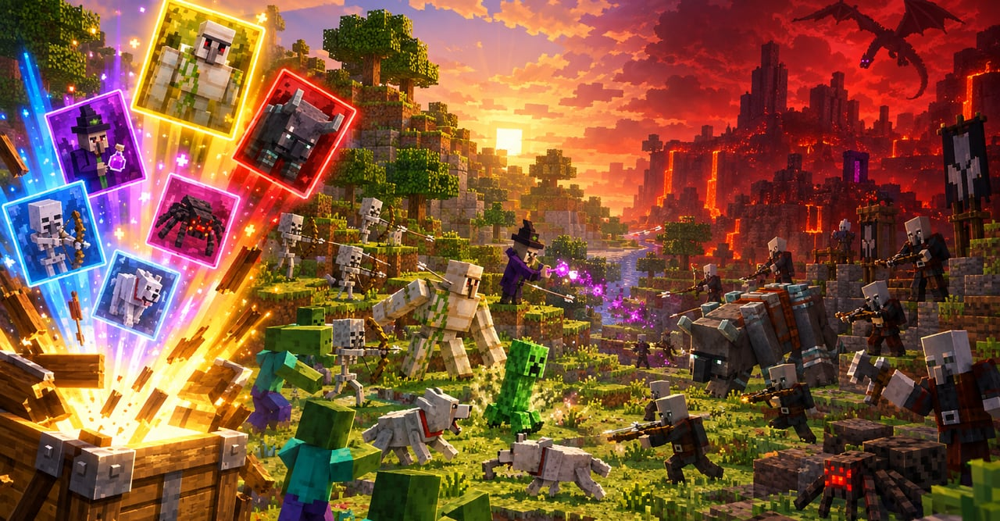</p>

<h1 align="center">方块尖塔 · Block Spire</h1>

<h3 align="center">下一箱，是僵尸，还是凋灵？</h3>

<p align="center">开箱组军 · 以怪斗怪 · 登塔屠龙</p>

<p align="center"><a href="https://blockspire.app"><b>▶ 在线游玩：blockspire.app</b></a></p>

<p align="center"><sub>网页游戏 · 打开即玩，无需下载</sub></p>

## 怎么玩

### 开箱

每赢一场，挑一个补给箱开启。生物分五档品质，从蓝到金，越稀有越强；重复开到同一种生物，它就会升星变强。

<p align="center">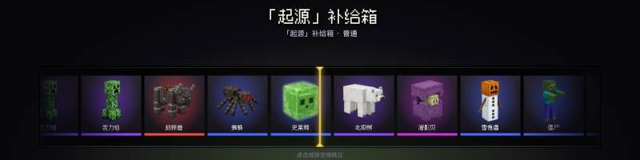</p>
<table>
  <tr>
    <td width="50%">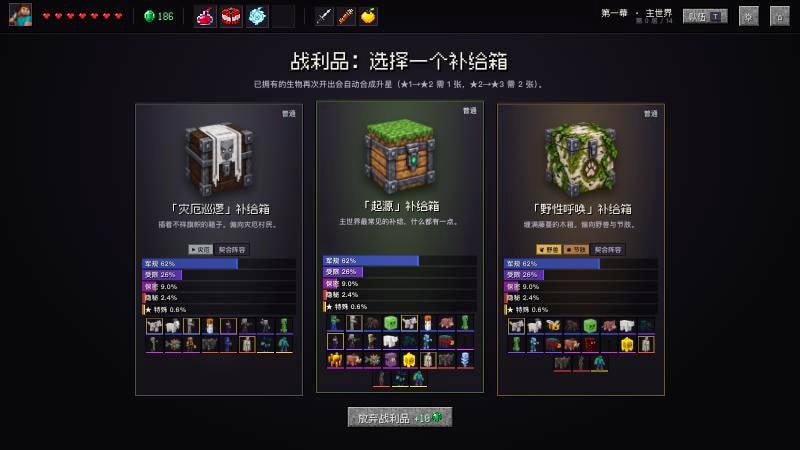</td>
    <td width="50%">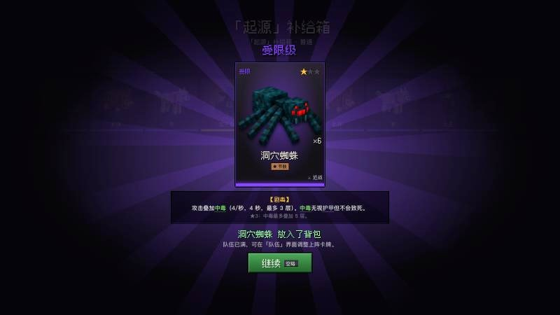</td>
  </tr>
</table>

### 爬塔

沿着分支地图一路向上，途中有战斗、精英、事件、商店和营火，每一幕的尽头都有首领在等你。

<p align="center">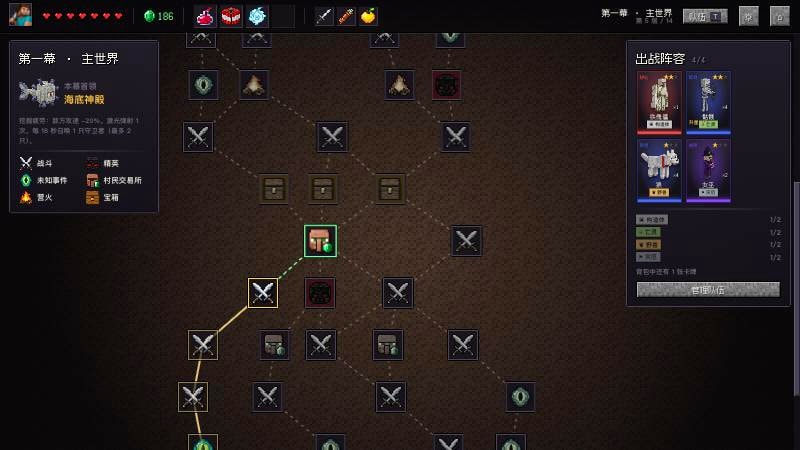</p>

### 布阵与混战

战前在 3D 战场上摆好阵型，开战后双方全自动混战。地形、站位和时机都可能左右胜负，关键时刻也可以亲自出手。

<table>
  <tr>
    <td width="50%">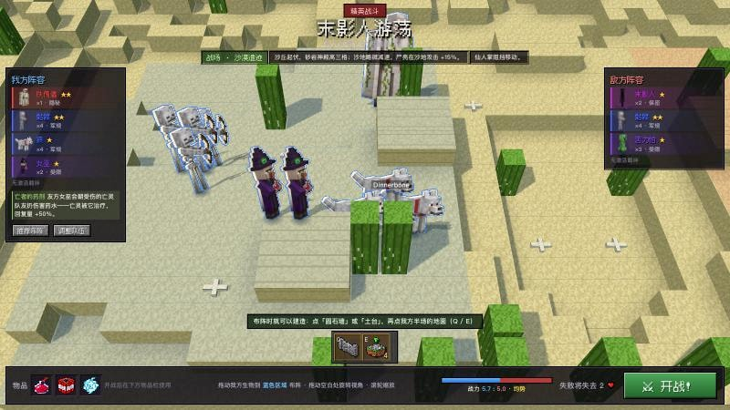</td>
    <td width="50%">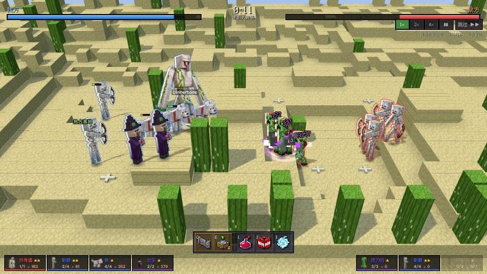</td>
  </tr>
</table>

### 构筑

羁绊、联动、附魔、宝物，再加上风格各异的统领，每一局的阵容都不一样。

## 战场

<table>
  <tr>
    <td width="50%">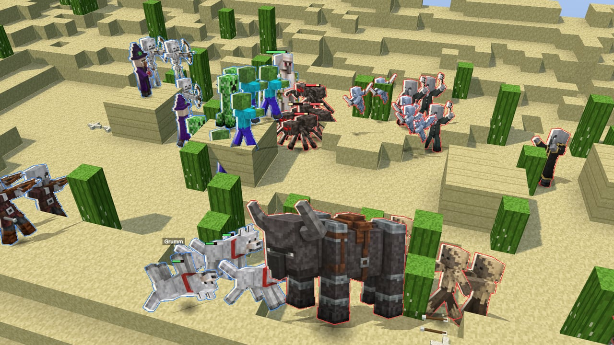</td>
    <td width="50%">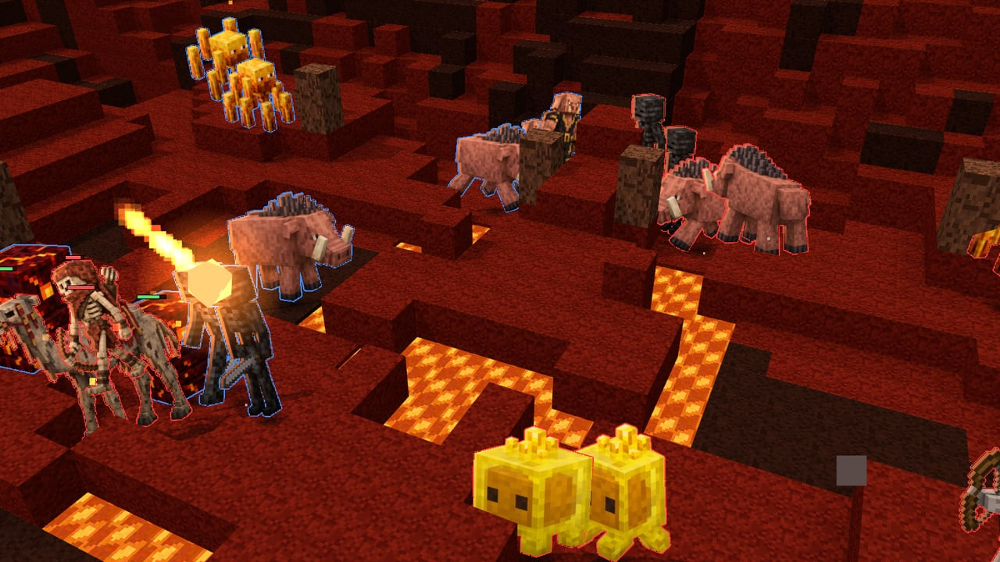</td>
  </tr>
  <tr>
    <td width="50%">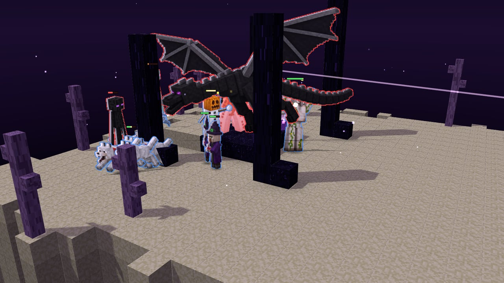</td>
    <td width="50%">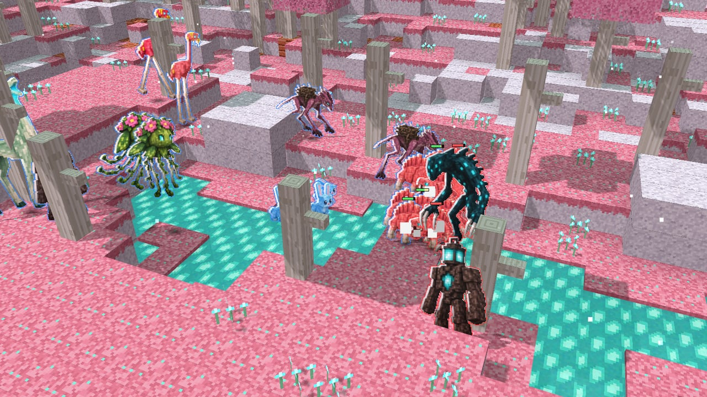</td>
  </tr>
</table>

## 游戏模式

- **爬塔**：主线模式，从第一个补给箱开始，一路打到最终首领。通关之后，还有更艰难的挑战等着你。
- **经典对决**：红蓝两方轮流开箱、各自组成阵容，最后一场混战定胜负。开战前不妨猜猜，哪一方会赢。

## 操作

| 场景 | 操作 |
|---|---|
| 开箱 | 空格 / 回车：开启或跳过动画；Esc：返回换箱 |
| 地图 | 点击节点前进；T 或 Tab：打开队伍面板 |
| 布阵 | 把己方生物拖到蓝色区域；拖动空白处旋转视角，滚轮缩放 |
| 战斗 | 数字键：使用物品；Q / E：统领技能；Esc：取消；可以切换倍速、暂停或跳过 |

## 本地运行

```bash
git clone https://github.com/moonwesif/BlockSpire.git
cd BlockSpire
npm install
npm run dev      # http://localhost:5199
npm run build    # 生成纯静态文件到 dist/，可部署到任意静态托管
```

技术栈：Preact + TypeScript + Three.js（Vite 构建）。

## 说明

- 非 Mojang / Microsoft 官方作品，与其无关联；Minecraft 是 Mojang 的商标。
- 生物立绘、图标、补给箱和场景图由 AI 生成，不使用 Mojang 的贴图或模型文件。
- 字体：[Fusion Pixel Font](https://github.com/TakWolf/fusion-pixel-font)（SIL OFL 1.1，见 `public/fonts/OFL.txt`）。
